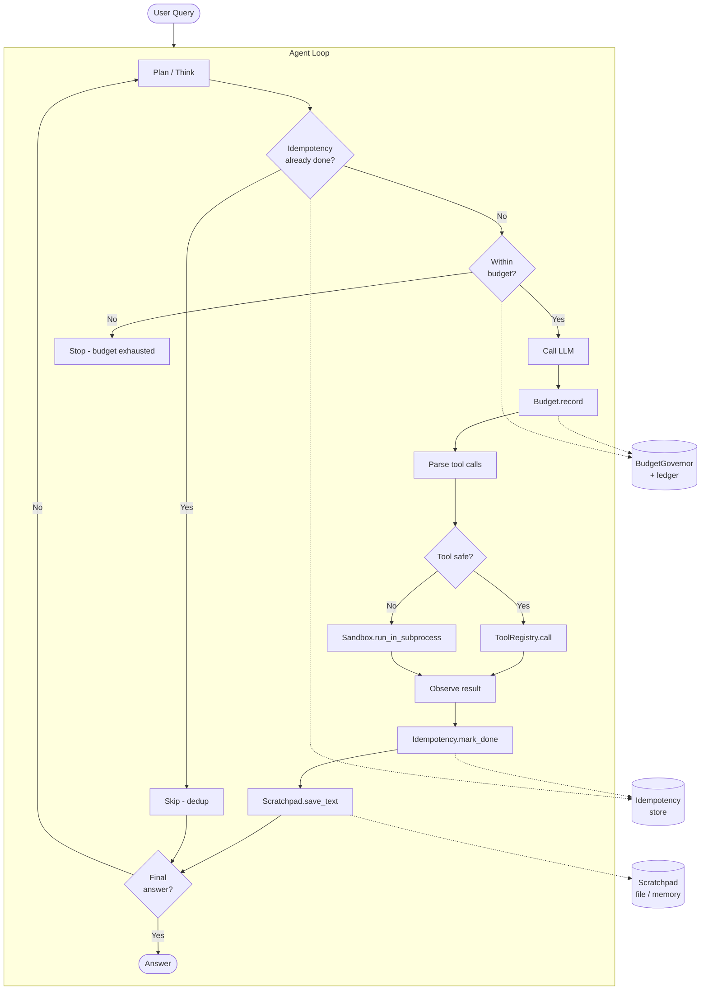

# tiny-agent-toolkit

> **A zero-dependency toolkit for building reliable, production-grade AI agents in Python.**

[](https://www.python.org/downloads/)
[](LICENSE)
[](#installation)
[](#tool-registry)

`tiny-agent-toolkit` collects the battle-tested patterns from the `tiny-*`
ecosystem (`tiny-agent`, `tiny-cost`, `tiny-store`, `tiny-circuit-breaker`,
`tiny-retry-plus`, …) into a single, focused package for **agent
reliability**: budget enforcement, idempotency, persistent context, tool
registry, structured logging, and sandboxed execution.

It does **not** ship its own agent loop — your framework (LangChain,
OpenAI Agents SDK, raw `tiny-agent`, or hand-rolled) plugs into these
primitives however you like.

## Features

- **Context management** — persistent scratchpads survive across turns and sessions.
- **Budget & cost tracking** — per-model pricing, per-call / total / daily caps, persistence.
- **Idempotency guards** — never double-charge, double-post, or double-send.
- **Tool registry** — export to OpenAI, Anthropic, and MCP schemas from one decorator.
- **Sandboxed execution** — AST sanitization + subprocess runner with POSIX resource limits.
- **Structured logging hooks** — first-class `Observable` mixin for trace events.
- **Zero dependencies** — pure stdlib, Python 3.8+.

## Installation

```bash
pip install tiny-agent-toolkit
```

Or copy any individual file from `tiny_agent_toolkit/` into your project —
every module is self-contained and uses only the standard library.

## Architecture



## Getting Started

### 1. Define some tools

```python
from tiny_agent_toolkit import ToolRegistry, tool

registry = ToolRegistry()

@tool(description="Add two numbers")
def add(a: float, b: float) -> float:
    return a + b

@tool(description="Multiply two numbers")
def multiply(a: float, b: float) -> float:
    return a * b

registry.register(add)
registry.register(multiply)

# Export to your favorite provider's schema:
print(registry.to_openai())     # OpenAI / Anthropic function-calling format
print(registry.to_anthropic())  # Anthropic-native tool format
print(registry.to_mcp())        # Model Context Protocol
```

### 2. Enforce a budget

```python
from tiny_agent_toolkit import BudgetGovernor, BudgetExceeded

budget = BudgetGovernor(
    limit_usd=1.00,             # total cap
    limit_per_call_usd=0.10,    # per-LLM-call cap
    limit_daily_usd=5.00,       # rolling 24h cap
    warn_at=0.5,               # on_warn() fires at 50%
    on_warn=lambda s, l: print(f"⚠  ${s:.4f} / ${l:.4f}"),
    persist_path="/var/log/agent/budget.jsonl",
)

# Inside your agent loop:
if not budget.can_afford("gpt-4o", input_tokens=1000, output_tokens=500):
    return  # refuse to call the LLM
budget.record("gpt-4o", input_tokens=1000, output_tokens=500)
```

### 3. Dedupe side-effects

```python
from tiny_agent_toolkit import IdempotencyGuard, FileIdempotencyStore

guard = IdempotencyGuard(
    store=FileIdempotencyStore("/var/lib/agent/dedup"),
    namespace="email-sender",
)

key = IdempotencyGuard.make_key("send", to="alice@example.com", body=msg)
if guard.already_done(key):
    return  # already sent this exact email
send_email(...)
guard.mark_done(key)
```

### 4. Persist context across sessions

```python
from tiny_agent_toolkit import DirectoryScratchpad

pad = DirectoryScratchpad("~/.my-agent/scratchpad")
pad.save("user_preferences", {"theme": "dark"})
pad.save_text("Turn 1", "User asked about OpenAI pricing.")
pad.save_text("Turn 2", "Fetched current rates; stored in 'rates' key.")

# Next session:
prefs = pad.load("user_preferences")
recent_notes = pad.notes()[-10:]  # last 10 turns
```

### 5. Run untrusted code safely

```python
from tiny_agent_toolkit import run_in_subprocess, ResourceLimits

result = run_in_subprocess(
    user_code,
    timeout_s=5.0,
    limits=ResourceLimits(cpu_seconds=5, memory_mb=128, file_size_mb=10),
)
if result.ok:
    print(result.stdout)
else:
    print(f"Refused: {result.stderr}")
```

Or statically scan with `inspect_source("import os; os.system('rm -rf /')")` to
block dangerous patterns **before** any execution.

### 6. Putting it together

See [`examples/reliable_agent.py`](examples/reliable_agent.py) — a complete
demo agent that uses every component to compute `(7²) × 3 + 5` while
enforcing budget, deduplicating tool calls, persisting context, and
sandboxing a user-supplied Python snippet.

```bash
python examples/reliable_agent.py
```

## Module Reference

### `budget` — `BudgetGovernor`

Per-model USD pricing, separate input/output rates, per-call / total / daily
limits, optional warn-at threshold, persisted JSONL ledger, thread-safe,
fuzzy model-name matching (`ft:gpt-4o-mini-2024-07-18` → gpt-4o-mini pricing).

```python
gov = BudgetGovernor(limit_usd=10.0, warn_at=0.7)
gov.set_price("my-custom-model", input_per_m=2.0, output_per_m=8.0)
gov.record(model="my-custom-model", input_tokens=5000, output_tokens=2000)
print(gov.stats())
# {'calls': 1, 'total_cost_usd': 0.026, 'cost_by_model': {...}, ...}
```

### `idempotency` — `IdempotencyGuard`

Two stores ship in the box:
- `InMemoryIdempotencyStore` (fast, per-process)
- `FileIdempotencyStore` (atomic temp+rename, cross-process, thread-safe)

Keys are SHA-256-hashed so any PII is one-way.

```python
guard = IdempotencyGuard(store=FileIdempotencyStore("/tmp/dedup"))
key = IdempotencyGuard.make_key("tool", name="send_email", to=email, body=msg)
if not guard.already_done(key):
    send_email(email, msg)
    guard.mark_done(key)
```

### `context` — Scratchpads

Three backends with the same API:

| Class                       | Persistence           | Concurrency | Best for                          |
|-----------------------------|-----------------------|-------------|-----------------------------------|
| `MemoryScratchpad`          | None                  | Thread-safe | Tests, ephemeral runs             |
| `FileScratchpad`            | One JSON file         | Thread-safe | Single-agent, single-process      |
| `DirectoryScratchpad`       | `state.json` + JSONL  | Thread-safe | Multi-session, checkpointed agents |

```python
pad = DirectoryScratchpad("/var/lib/agent/pad")
pad.save("last_user", "alice")
pad.append("history", "asked about pricing")
pad.save_text("turn-1", "user asked about X", model="gpt-4o")
print(pad.notes()[-3:])  # last 3 turns
```

### `tools` — ToolRegistry

Auto-introspects Python type hints to build JSON Schema. Decorator or
direct registration both supported.

```python
from tiny_agent_toolkit import ToolRegistry, tool

@tool(description="Greet someone")
def greet(name: str, greeting: str = "Hello") -> str:
    return f"{greeting}, {name}!"

reg = ToolRegistry()
reg.register(greet)
reg.to_mcp()
# [{'name': 'greet', 'description': 'Greet someone',
#   'inputSchema': {'type': 'object', 'properties': {...}, ...}}]
```

### `sandbox` — Static + dynamic execution guards

- `inspect_source(code)` — static AST scan; returns a list of issues.
- `SanitizedExec` — in-process exec with hard-allowlisted builtins.
- `run_in_subprocess(code, timeout_s=..., limits=ResourceLimits(...))` —
  runs `code` in a fresh Python subprocess with optional POSIX rlimits
  (CPU, memory, file size, nproc, nofile).

```python
from tiny_agent_toolkit import inspect_source, run_in_subprocess, ResourceLimits

issues = inspect_source("import os; os.system('rm -rf /')")
# ['banned_import:os (line 1)', 'banned_call:os.system (line 1)']

r = run_in_subprocess(
    "print(sum(range(100)))",
    timeout_s=2.0,
    limits=ResourceLimits(memory_mb=64),
)
print(r.stdout)  # 4950
```

## Why tiny-agent-toolkit?

Most agent frameworks ship one giant opinionated runtime. When you need
to drop a custom LLM, replace the storage layer, or run a tool in a
sandbox, you fight the framework. `tiny-agent-toolkit` is the opposite:
**small, composable primitives** you can assemble into whatever shape
your agent needs.

It's also truly **zero-dependency**. No `httpx`, no `pydantic`, no
`tiktoken`, no `numpy`. The whole package is ~1500 lines of pure Python
that runs anywhere CPython does.

## Development

```bash
git clone https://github.com/hussain-alsaibai/tiny-agent-toolkit
cd tiny-agent-toolkit
pip install -e ".[dev]"
pytest tests/
```

Run the example:

```bash
python examples/reliable_agent.py
```

## Project status

`tiny-agent-toolkit` is **0.1.0** — the public API may still evolve
before 1.0. Backwards-incompatible changes will be noted in `CHANGELOG.md`.

## Related projects

The toolkit distills patterns from the wider `tiny-*` ecosystem:

| Project                                          | What it does                                     |
|--------------------------------------------------|--------------------------------------------------|
| [tiny-agent](https://github.com/tiny-agent/tiny-agent) | Single-file ReAct agent loop with tools      |
| [tiny-cost](https://github.com/tiny-agent/tiny-cost)   | Standalone token-cost library (Node + Python) |
| [tiny-store](https://github.com/tiny-agent/tiny-store) | Filesystem KV with TTL, search, pagination    |
| [tiny-circuit-breaker](https://github.com/tiny-agent/tiny-circuit-breaker) | Fault-isolation for external calls |
| [tiny-retry-plus](https://github.com/tiny-agent/tiny-retry-plus) | Retry with backoff, jitter, dead-letter |
| [tiny-mcp-observability](https://github.com/tiny-agent/tiny-mcp-observability) | Observability for MCP servers |

## License

MIT — see [`LICENSE`](LICENSE). Copyright © 2026 Hussain Al-Saibai.